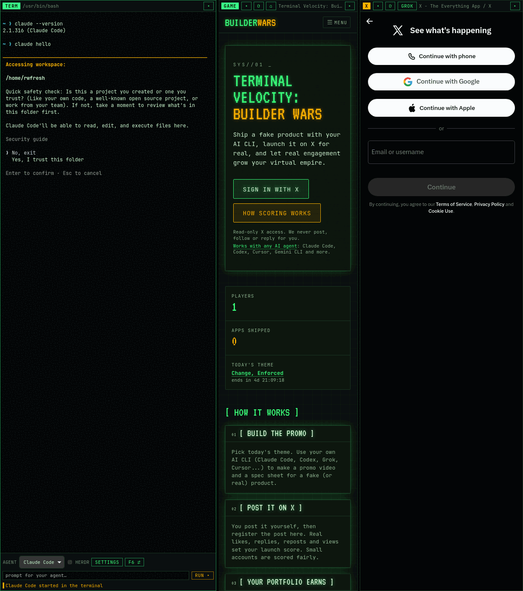

# Builder Wars launcher (spike)

Tauri 2 desktop shell for Builder Wars (ARCHITECTURE.md §14). One window with three panes:

- **Terminal** (left): xterm.js wired to our own PTY commands over `portable-pty`. It runs your login shell (`$SHELL`, falling back to bash; PowerShell on Windows), or `herdr --session builderwars` when herdr mode is on. The toolbar under it has the agent picker, the herdr toggle, settings, a prompt box and the focus-cycle button.
- **Game** (center): `https://builderwars.ai/dashboard` in a **child webview**. It is not an iframe, so the site's cookies are first-party and "Sign in with X" works inside the pane.
- **X** (right): `https://x.com` in a **child webview**. A toggle switches it to the Grok chat URL. It has back and reload buttons.

The game and X webviews share one persistent profile (`<app local data>/web-profile`, which is `~/.local/share/ai.builderwars.launcher/web-profile` on Linux). You sign in to X once, and the login survives restarts.



`docs/spike.png` is built from WebKit's own snapshots of the three webviews, composited at their real GTK positions. `grim` hangs on this machine, so I could not take a compositor screenshot.

## Run

```bash
pnpm --filter @builderwars/launcher tauri dev            # dev (Vite on :1420 + cargo run)
pnpm --filter @builderwars/launcher tauri build --no-bundle   # release binary
apps/launcher/src-tauri/target/release/builderwars-launcher   # run it
```

Options (CLI or env):

| | |
|---|---|
| `--url http://localhost:3000` or `BW_SITE_URL=...` | Game site URL. The bridge trusts only this origin. Precedence: `--url`, then env, then the setting, then `https://builderwars.ai`. |
| `BW_USE_HERDR=0/1` | Overrides the herdr setting for this run (not saved). |
| `BW_KEEP_DMABUF=1` | Keeps WebKitGTK's DMA-BUF renderer. By default we set `WEBKIT_DISABLE_DMABUF_RENDERER=1`, because it crashed once here (Wayland + NVIDIA: `Error 71 (Protocol error)`). |
| `BW_AUTOTEST=1` | Self-test: types `claude --version`, calls `builderwarsLauncher.runPrompt('hello','claude')` from inside the game page, checks that the ACL denies a shell-only command from the site, drags a divider and collapses/expands X. Results go to stdout. |
| `BW_PTY_LOG=file`, `BW_SNAPSHOT_DIR=dir`, `BW_DEBUG_BOUNDS=1` | Spike diagnostics: raw PTY output, per-webview PNG snapshots with GTK allocations, child-webview bounds. |

Tests: `pnpm --filter @builderwars/launcher test` (vitest: agent CLI mapping and quoting, bridge init script and payloads, layout math) and `cargo test` in `src-tauri`.

## Bridge (site <-> launcher), v1

The launcher injects `src-tauri/src/bridge_init.js` as an initialization script into the **game webview only**. The script does nothing unless the top-level page is on the configured site origin, so an OAuth hop to x.com in that webview gets nothing. On the site origin it defines:

```ts
window.builderwarsLauncher = {
  version: 1, platform: "linux" | "macos" | "windows", agents: string[], defaultAgent: string | null, herdr: boolean,
  runPrompt(prompt: string, agent?: string | null): Promise<{ agent: string }>, // rejects with Error(message)
  openX(url?: string | null): Promise<void>,                                   // https://x.com URLs only
}
```

The TypeScript contract is `BuilderwarsLauncherApi` in `src/bridge.ts`.

**Transport: Tauri IPC from the remote origin.** At startup the launcher adds a runtime capability (`game-bridge`). It is scoped to the `game` webview plus `<site origin>/*` and grants exactly `allow-run-prompt` and `allow-open-x`. App commands are deny-by-default: `build.rs` declares them in an `AppManifest`. The shell's own capability (`capabilities/shell.json`) applies only to the local `shell` webview. Every shell command also checks the caller label. The self-test confirmed this: `pty_write` called from builderwars.ai is rejected with `not allowed on ... webview "game"`. I did not need the custom-scheme fallback.

How a prompt runs: Rust's `run_prompt` validates the prompt (non-empty, at most 16,000 chars, no NUL) and the agent id. It then emits `bridge:run-prompt` to the shell UI, which owns the terminal. The shell chooses the agent, quotes the prompt and types the command (or dispatches it through herdr), then answers through `bridge_resolve`. That answer resolves the site's promise.

## Agents and herdr

- On startup the launcher reads `PATH` from your login shell, because desktop launchers often have a minimal one. It then detects `claude`, `codex`, `gemini`, `grok` and `opencode`.
- Initial-prompt syntax, verified on this machine: `claude "<p>"`, `codex "<p>"`, `gemini -i "<p>"`, `grok "<p>"`, `opencode --prompt "<p>"`. Prompts are cleaned (control and escape characters stripped, tabs turned into spaces) and quoted for POSIX shells, fish or PowerShell (`src/agents.ts`).
- Without herdr, the command is typed only when the shell is idle (the PTY's foreground process group is the shell). Otherwise the site gets "the terminal is busy".
- **herdr mode** (on by default when `herdr` is installed): the pane runs `herdr --session builderwars`, a dedicated session that never touches your default one. `HERDR_*` variables are stripped so it works even when the launcher itself was started inside herdr. To dispatch a prompt, the launcher calls `herdr pane list` to find the focused pane and `pane process-info` to check that its shell is idle. If it is busy, it calls `pane split --direction right`. Then `pane run <pane> "<agent command>"`.
- **Why not `agent start` + `agent prompt`:** `agent start` returns `agent_not_ready` when the CLI opens a first-run or trust dialog (Claude's "trust this folder?"), and the prompt would be lost. Passing the prompt as the CLI's initial argument survives those dialogs, and herdr still detects and tracks the agent ("blocked" or "idle").
- The herdr session keeps running after the launcher quits (that is how herdr works). Stop it with `herdr session stop builderwars`.

## Layout notes

- Child webviews always draw above the shell webview, so nothing of ours renders inside the pane rectangles. Settings take over the terminal column, and dropdowns live in the left toolbar.
- On Linux, Tauri packs child webviews into the window's GtkBox, where `set_bounds` does nothing. We re-parent them into `GtkOverlay { shell webview, GtkFixed(pass-through) { game, x } }` and position them ourselves (`panes.rs`).
- WebKitGTK scales CSS px by the desktop text scale (1.1 on this Wayland session, 1.0 under X11). Bounds from the shell are therefore converted with child-layer size divided by the shell viewport size.
- **F6** cycles focus (terminal, game, X). On Linux it is caught at the GtkWindow level, so it works while x.com has focus. Ctrl+` works from the shell. On macOS and Windows F6 only works while the shell has focus (follow-up: menu accelerator).

## What works (Linux, Omarchy/Hyprland, NVIDIA)

- PTY plus xterm, `claude --version` (2.1.316), and `runPrompt` typing `claude hello` (from the toolbar and from the site through the bridge), in both plain-shell and herdr mode.
- Game child webview loads builderwars.ai, the bridge round-trip works, and the ACL denies everything else.
- X child webview loads x.com (the login page renders). Page-load and title events reach the shell header. The cookie jar persists: the same `guest_id` came back after a restart. Back (native `webkit_web_view_go_back`), reload and the Grok/Home toggle are wired up.
- Divider drag, collapse and expand reposition and resize the child webviews (checked against GTK allocations).
- Wayland (native) and X11 (`GDK_BACKEND=x11`, through Xwayland) both start. Dev and release builds both work.
- Idle CPU over 30 s for the whole process tree (launcher, 4 WebKit processes, shell or claude): about 0.9 % of one core.

## Not done / not verified

- **A human X login** has not been done yet. Persistence is inferred from WebKit's on-disk cookie jar (`web-profile/cookies`) surviving restarts.
- Clicking a real "Run in terminal" button on the site: the site side is still being built. The self-test calls the same `window.builderwarsLauncher.runPrompt` from inside the page.
- Settings save through the UI has not been run end to end. It is `settings_set`, which writes `~/.config/ai.builderwars.launcher/settings.json`.
- Under X11 with Omarchy's global `GDK_SCALE=2`, the window is 616 logical px wide, which is too narrow for the three-pane minimums. It works with `GDK_SCALE=1`.
- The deep link `builderwars://run?prompt=...&agent=...` is not done. Follow-up: `tauri-plugin-deep-link`, which needs the .desktop/Info.plist/registry registration that only exists in bundled builds. Route it to the same `bridge:run-prompt` path, with a confirmation, because any web page can open a deep link.
- The tray is behind the Cargo feature `tray`, which is off (`libayatana-appindicator` is not installed).
- Agents start in `$HOME`. Claude then asks to trust the home folder. Follow-up: a work-directory setting, for example `~/BuilderWars`.

## Windows and macOS (untested)

- Windows: WebView2. PTY through ConPTY (portable-pty), running `powershell.exe -NoLogo`. Child webviews use Tauri's native `set_bounds`. Webviews are created in `setup`, not from a sync command. Native back is still a TODO (`ICoreWebView2::GoBack` via `with_webview`; it returns an error for now). The game and X webviews must share one WebView2 environment for the shared profile.
- macOS: WKWebView. `data_directory` is ignored on macOS, where `data_store_identifier` (macOS 14+) is the equivalent, so the X login lands in the default store for now. Native back is a TODO (`goBack`).
- Both: run `pnpm tauri dev` on each OS before calling it supported. On macOS, Gatekeeper requires signing (below).

## Packaging and signing (follow-ups from §14)

- `.github/workflows/launcher.yml` with `tauri-apps/tauri-action`, building on Linux (AppImage, deb, rpm), Windows (msi/nsis) and macOS (dmg), with artifacts on GitHub Releases.
- macOS: Developer ID Application certificate plus notarization through the secrets `APPLE_CERTIFICATE`, `APPLE_CERTIFICATE_PASSWORD`, `APPLE_SIGNING_IDENTITY`, `APPLE_ID`, `APPLE_PASSWORD`, `APPLE_TEAM_ID`.
- Updater: `tauri-plugin-updater` with `TAURI_SIGNING_PRIVATE_KEY` (and its password). Windows stays unsigned until a certificate exists.
- Linux tray: enable `--features tray` once the build image has libayatana-appindicator.
- Icons in `src-tauri/icons` are generated placeholders (`tauri icon`).

## Security notes

- x.com gets no scripts of ours: no init script, no `eval`, no DOM access, no automation. We only set its bounds and navigate, go back or reload on a user click. Caveat: Tauri itself adds its IPC bootstrap (`__TAURI_INTERNALS__`) to every webview it creates, x.com included. No capability matches x.com, so every IPC call from there is denied. Electron would avoid even that injection.
- Any page on the site origin can type a prompt into the player's terminal and start an agent. That is the feature, but an XSS on builderwars.ai would turn it into prompt injection into a local agent. Consider a confirm step or allow-list before shipping.
